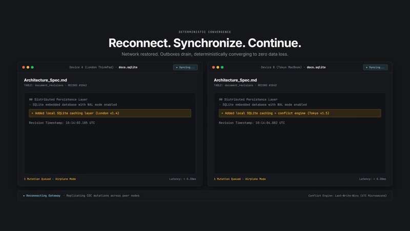

# tauri-plugin-sync

> **Zero-Configuration Local-First SQLite Replication & Sync Engine for Tauri v2.**

[](https://www.npmjs.com/package/tauri-plugin-sync)
[](https://crates.io/crates/tauri-plugin-sync)
[](https://opensource.org/licenses/MIT)
[](https://v2.tauri.app)
[](https://github.com/kxrn-gupta/tauri-plugin-sync/actions)

<p align="center">
  
</p>

`tauri-plugin-sync` enables developers to build real-time, offline-first desktop applications with Tauri v2. Write to local SQLite with sub-millisecond median latency (0.13ms p50 / 0.34ms mean), and let the background sync engine seamlessly replicate changesets to your remote cloud backend with deterministic Last-Write-Wins (LWW) conflict resolution.

---

## Features

- ⚡ **Sub-Millisecond Local Writes:** Median (p50) latency of 0.13ms and mean latency of 0.34ms with zero network blocking.
- 🔄 **Automatic Change Data Capture (CDC):** Shadow triggers track inserts, updates, and deletes without changing existing application SQL.
- 📴 **Offline-First Resilience:** Network disconnects queue mutations locally; auto-sync resumes instantly when back online.
- 🛡️ **Deterministic Conflict Resolution:** Last-Write-Wins (LWW) with microsecond tiebreakers and tombstone deletion support.
- 🔁 **Infinite Loop Immunity:** Session-level recursion suppression guarantees inbound sync never re-triggers local CDC triggers.
- 📦 **Modern TypeScript SDK:** Full TypeScript definitions, reactive status listeners, and manual sync controls.

---

## Installation

### 1. Install JavaScript / TypeScript SDK
```bash
npm install tauri-plugin-sync
# or
pnpm add tauri-plugin-sync
# or
yarn add tauri-plugin-sync
```

### 2. Add Rust Backend Crate
In your `src-tauri/Cargo.toml`:
```toml
[dependencies]
tauri-plugin-sync = "0.1"
```

---

## Quick Start

### Frontend (TypeScript / JavaScript)

```typescript
import { SyncManager } from 'tauri-plugin-sync';

// 1. Initialize Sync with your local SQLite database
const sync = await SyncManager.init({
  database: 'app.db',
  endpoint: 'https://api.example.com/sync',
  tables: ['todos', 'notes'],
  authHeader: 'Bearer eyJhbGciOi...',
  syncIntervalMs: 5000, // background polling interval (ms)
  batchSize: 500,       // maximum changes per batch
});

// 2. Listen to reactive sync status ('idle' | 'syncing' | 'offline' | 'error')
sync.onStatusChange(({ state, pendingCount, lastSyncTime }) => {
  console.log(`Sync Status: ${state} (Pending: ${pendingCount})`);
});

// 3. Trigger manual synchronization on demand
await sync.syncNow();
```

### Backend (Rust / Tauri v2)

In `src-tauri/src/lib.rs` (or `main.rs`):

```rust
use tauri_plugin_sync::Builder as SyncBuilder;

pub fn run() {
    tauri::Builder::default()
        .plugin(
            SyncBuilder::new()
                .database("app.db")
                .endpoint("https://api.example.com/sync")
                .bearer_token("YOUR_AUTH_TOKEN") // Securely managed in Rust backend (XSS-safe)
                .tables(vec!["notes".into(), "todos".into()])
                .sync_interval(std::time::Duration::from_secs(5))
                .build()
        )
        .run(tauri::generate_context!())
        .expect("error while running tauri application");
}
```

---

## Verified Benchmarks (1,000 Iteration Sample)

| Test Scenario | Measurement | Benchmark Result | Architectural Guarantee |
| :--- | :--- | :---: | :--- |
| **Local SQLite Mutation (p50)** | Single-row INSERT / UPDATE | `0.13 ms` (p50) | Pure local execution; zero network blocking |
| **Local SQLite Mutation (Mean)** | Average across 1,000 rows | `0.34 ms` (mean) | Sustained unbatched writes |
| **Local SQLite Mutation (p99)** | Tail latency during checkpoint | `1.00 ms` (p99) | Predictable performance even during WAL checkpointing |
| **CDC Trigger Overhead (p50)** | Shadow table changelog capture | `< 0.09 ms` (p50) | Seamless delta logging with zero application refactoring |
| **Concurrent Write Stress** | 10 concurrent threads × 100 ops | `1,000 ops in ~1.02s` | Zero `database locked` errors via WAL mode busy timeout |
| **Conflict Convergence** | LWW timestamp vs. Tombstones | `Deterministic` | Deletions strictly defeat stale historical updates |
| **Schema Drift Resilience** | Unexpected server-side columns | `Zero failures` | Local engine strips unknown columns gracefully |

---

## Resources & Documentation

- 📖 **[Deep-Dive Architecture Article (Medium)](https://medium.com/@karan5028ji/building-an-offline-first-sqlite-sync-engine-for-tauri-v2-desktop-apps-d673f8ed54d1)**
- 🌐 **[Official Showcase Website](https://kxrn-gupta.github.io/tauri-plugin-sync/)**
- 📦 **[Crates.io Registry](https://crates.io/crates/tauri-plugin-sync)**
- 🐙 **[GitHub Repository](https://github.com/kxrn-gupta/tauri-plugin-sync)**

---

## License

MIT OR Apache-2.0. Copyright (c) 2026 Chitresh (Kxrn) Gupta (Gupta Ventures).
